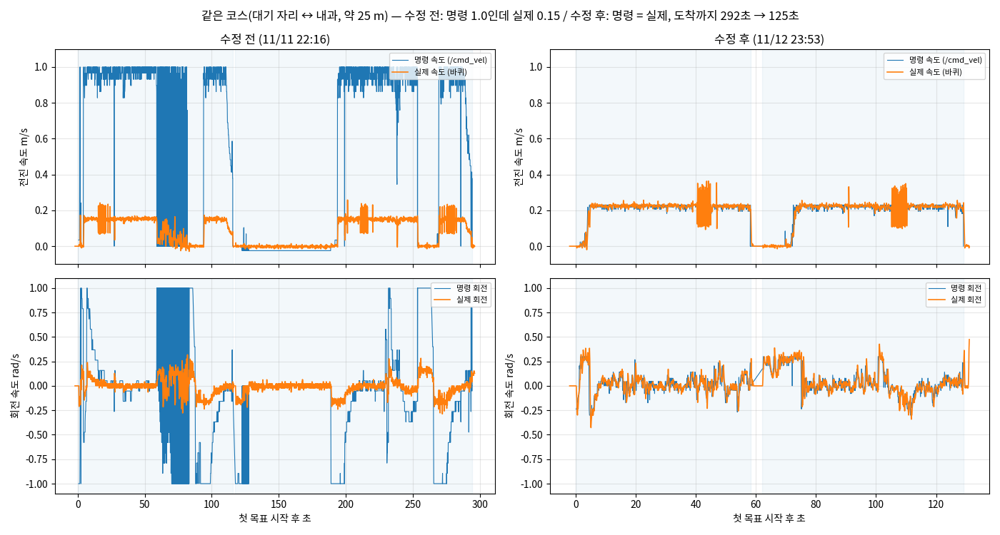

# 주행 개선 보고서 — rosbag 수정 전·후 비교 (2026-11-11 ~ 11-13)

> 대상: 병원 안내 로봇(Jetson AGX Xavier + Nav2 Galactic + DWB). 브랜치 `ui-dev`(앱·스크립트) / `cart_ros2`(로봇 설정·드라이버).
> 계기: "자꾸 부딪히고, 주행이 부드럽지 않다" → 주행을 rosbag 으로 녹화해 근본 원인을 찾고 고친 기록.
> 모든 수치는 아래 두 녹화를 같은 분석 코드(`scripts/compare_nav_bags.py`)로 잰 값이다.

---

## 1. 요약

**같은 코스(대기 자리 ↔ 내과, 약 25 m, 목표 2개)에서 도착까지 걸린 시간이 292초 → 125초(−57%)로 줄었고,
제어가 밀리던 현상(분당 170회 → 1.3회)과 복구 동작(11회 → 1회)이 거의 사라졌다.**

가장 큰 원인은 설정 튜닝이 아니라 **모터 속도 환산 계수 오류**였다. 로봇은 Nav2 가 명령한 속도의 **15.6%** 로만 움직이고 있었고,
Nav2 는 "1.0 m/s 로 가라"고 명령하면서 실제로는 0.15 m/s 로 움직이는 로봇을 예측·제어하고 있었다.
여기에 **CPU 포화**(제어 주기를 못 지킴), **로봇 모양 오인**(사각 차체를 작은 원으로 인식), **드라이버·기동 버그**가 겹쳐 있었다.

| 핵심 지표 | 수정 전 | 수정 후 | 변화 |
|---|---|---|---|
| 같은 코스 주행 시간 | 292 s | **125 s** | −57% |
| 움직일 때 평균 속도 | 0.138 m/s | **0.219 m/s** | ×1.6 |
| 실제 속도 ÷ 명령 속도 | **0.16** | **1.00** | 명령대로 움직임 |
| 제어 주기 미달 경고 | 170.6 회/분 | **1.3 회/분** | −99% |
| 이동 중 속도 명령 끊김(>0.25 s) | 17 | **0** | 해소 |
| 복구 동작(제자리 회전·후진 등) | 11 | **1** | −91% |
| 지역 costmap "센서 원점이 지도 밖" | 57 | **0** | 해소 |
| 명령 회전 방향 뒤집힘 | 88.8 회/분 | **21.5 회/분** | −76% |



*위: 전진 속도 · 아래: 회전 속도. 파랑 = Nav2 명령, 주황 = 실제(바퀴). 수정 전에는 명령 1.0 에 실제 0.15, 회전 명령이 ±1.0 사이를 오가며 요동.
수정 후에는 명령과 실제가 겹친다.*

---

## 2. 비교 조건

| | 수정 전 | 수정 후 |
|---|---|---|
| 녹화 | `/mnt/ssd/bags/nav_20261111_221640_충돌재현` | `/mnt/ssd/bags/nav_20261112_235325_최종` |
| 녹화 길이 | 646 s | 187 s |
| 코스 | 대기 자리 → 내과 → 대기 자리(목표 2개, 둘 다 성공) | 같음(목표 2개, 둘 다 성공) |
| 주행 거리(바퀴) | 24.9 m | 24.7 m |
| 전원 모드 | 30W_6CORE(모드 4) | 30W_ALL(모드 3) |
| 설정 | 수정 전 원본(백업 `agv.yaml.bak_before_footprint_cpu_20261111`) | 현재(아래 4절) |

- 지표는 **목표 진행 구간(주행 중)** 만 잰다. 근접 거리는 LiDAR 점과 **실제 차체 사각형(0.9 × 0.7 m)** 사이 거리.
- 녹화·분석 도구: `scripts/record_nav_bag.sh`(녹화), `scripts/analyze_nav_bag.py`(한 녹화 정밀 분석 → report.md·그림),
  `scripts/compare_nav_bags.py`(여러 녹화 비교표).
- ⚠ 수정 후 녹화는 `/scan_multi`(LiDAR 병합)가 녹화기 QoS 문제로 0개 기록됨(로봇 동작과 무관, 녹화기는 수정함) →
  수정 후 근접 거리는 LiDAR 2대의 개별 스캔으로 계산했다. 계산 방식이 약간 달라 근접 지표는 참고용.

---

## 3. 전체 비교표와 해석

| 지표 | 수정 전 | 수정 후 |
|---|---|---|
| 목표 수(성공/전체) | 2/2 | 2/2 |
| 주행 시간 합(s) | 292 | 125 |
| 주행 거리(m, 바퀴) | 24.9 | 24.7 |
| 평균 속도(m/s, 거리÷시간) | 0.085 | 0.197 |
| 움직일 때 평균 속도(m/s) | 0.138 | 0.219 |
| 실제 속도 상위 5%(m/s) | 0.162 | 0.240 |
| 설정 최고 속도 max_vel_x | 1.0 | 0.23 |
| 실제 / 명령 속도 비율 | 0.16 | 1.00 |
| 속도 명령 주기(Hz) | 12.3 (설정 20) | 9.7 (설정 10) |
| 제어 주기 미달 경고(회/분) | 170.6 (총 1835) | 1.3 (총 4) |
| 이동 중 명령 끊김 >0.25s | 17 | 0 |
| 명령 회전 방향 뒤집힘(회/분) | 88.8 | 21.5 |
| 실제 회전 방향 뒤집힘(회/분) | 10.5 | 34.5 |
| 직진 중 좌우 흔들림 크기(rad/s RMS) | 0.033 | 0.062 |
| 흔들림 ÷ 전진 속도(rad/m) | 0.23 | 0.28 |
| 실제 가속도 상위 5%(m/s², 바퀴 잡음 포함) | 0.36 | 0.54 |
| 근접 이벤트(<0.15 m, 주행 중) | 10 (2.05/분) | 4 (1.91/분) |
| 주행 중 최소 여유 거리(m) | 0.000 | 0.016 |
| 복구 동작 횟수 | 11 | 1 |
| '진행 못 함' 실패 | 2 | 1 |
| 지역 costmap 센서 원점 밖 | 57 | 0 |
| LiDAR 병합 스캔 버림 | 301 (28/분) | 90 (29/분) |

### 좋아진 것
- **속도·소요 시간**: 같은 거리를 2.3배 빠르게. 명령과 실제가 일치(0.16 → 1.00)해 Nav2 의 예측이 맞게 됨.
- **제어 안정성**: 제어 주기 미달 −99%, 명령 끊김 0. 명령 회전 방향 뒤집힘 −76%(그림 아래쪽: ±1.0 요동이 사라짐).
- **막힘·복구**: 복구 동작 11 → 1, 지역 costmap 이 로봇 위치를 못 따라가던 현상 57 → 0.

### 그대로이거나 나빠진 것 (정직하게)
- **실제 좌우 흔들림은 줄지 않았다.** 흔들림 크기 0.033 → 0.062 rad/s, 진행 거리당 0.23 → 0.28 rad/m.
  수정 전에는 회전 명령이 실제로는 15.6% 만 전달돼 흔들림이 '눌려' 있었고, 지금은 명령이 그대로 전달된다.
  (사용자 체감은 "많이 좋아짐" — 수정 전의 큰 요동·막힘이 사라진 효과로 보인다.) → 5절 남은 과제.
- **근접은 빈도 비슷**(분당 2.05 → 1.91). 수정 후 4건은 모두 한 스캔짜리 순간이며 위치는 아래와 같다.

  | 시점 | 최소 거리 | 부위 | 상황 |
  |---|---|---|---|
  | 목표 1 시작 2.4 s 후 | 6.6 cm | 앞면 | 대기 자리에서 제자리 회전 — 대기 자리 앞 물체(아래 5절) |
  | 목표 1 진행 중 | 10.8 cm | 왼쪽 옆면 | 0.22 m/s 직진 |
  | 목표 2 진행 중 | 11.2 cm | 왼쪽 옆면 | 0.22 m/s 직진 |
  | 목표 2 도착 5 s 전 | 1.6 cm | 앞면 | 대기 자리 접근 — 같은 물체로 추정 |
- **LiDAR 병합 스캔 버림**은 분당으로 보면 그대로(28 → 29). 허용 시간을 늘렸지만 효과 없음.
- **속도 출렁임**: 명령은 일정한데 실제 속도만 짧게 출렁이는 구간이 수정 전·후 모두 있다(그림 위쪽, 수정 후 42 s·108 s 부근). 5절.

---

## 4. 무엇을 어떻게 고쳤나 — 원인 → 근거 → 수정 → 효과

### 4.1 모터 속도 환산 오류 (가장 큰 원인)
- **증상**: "너무 느리다". 복귀 후 방향 정렬 코드에 이미 "명령 0.4 rad/s 를 줘도 실제 0.048(12%)" 라는 메모가 있었음
  — 예전부터 명령을 부풀려 버텨 왔다.
- **근거**: 수정 전 녹화의 안정 구간 회귀 — **실제 ÷ 명령 = 0.156**. 왼쪽·오른쪽 바퀴, 직진(508 표본)·제자리 회전(552 표본) 모두 같고
  잔차 0.02 m/s. 바퀴로 잰 속도(odom)와 지도 기준 실제 이동 속도는 일치 → 위치 계산은 정확, **명령→모터 회전수 환산만** 6.4배 틀림.
- **수정** (`cart_ros2` 91c9d75): `roboteq_controller/config/query.yaml` `wheel_circumference` **0.15 → 0.0234**
  (= 0.15 × 0.156. 코드 주석의 실제 바퀴 둘레 0.6594 m ÷ 감속비 약 28 과도 일치 — 모터 RPM 기준 환산값).
  이후 모든 속도 한도를 '실제 값'으로 다시 잡음(4.4).
  부풀린 값을 쓰던 곳도 함께 낮춤: 복구 회전 1.0/0.4/3.2 → 0.5/0.2/1.0 rad/s, 복귀 방향 정렬 상한 0.8 → 0.35·최소 0.12 → 0.08·위글 0.4 → 0.25 (`ui-dev` 208d212).
- **효과**: 실제/명령 0.16 → **1.00**.

### 4.2 CPU 포화 → 제어 주기를 못 지킴
- **근거(수정 전)**: 컨트롤러 "Control loop missed 20 Hz" 1835회(실제 12.3 Hz), 0.25 s 넘는 명령 끊김 17회(최장 0.5 s),
  지역 costmap 이 로봇 위치를 못 따라감 57회. CPU 6코어 92~100%.
  주범: IMU 드라이버 1 ms 타이머(`/imu/data` **908 Hz**) + 읽기 루프 무휴식, DWB 디버그 출력, 같은 스캔을 두 계층이 중복 처리, 전원 모드 6코어.
- **수정**:
  - 전원 모드 **30W_6CORE → 30W_ALL**(같은 30 W 에 8코어). 부팅 스크립트 기본값과 **서비스 파일의 `AGV_POWER_MODE=4` 덮어쓰기**를 모두 3으로
    (`ui-dev` 2b1c152, 959f0d7 — 서비스 파일은 `/etc` 에 복사·`daemon-reload` 필요). MAXN 은 모터 기동 때 젯슨이 꺼져 제외.
  - IMU 발행 **100 Hz** 파라미터화(`stella_ahrs` `publish_rate_hz`), 데이터 없을 때 0.5 ms 휴식 (`cart_ros2` c167f55, 빌드).
  - DWB `debug_trajectory_details: false`, 지역·전역 costmap 의 중복 `voxel_layer` 끔, 컨트롤러 주기 20 → **10 Hz**(지킬 수 있는 값),
    `vx_samples` 30 → 20 (c167f55).
  - RViz 를 끌 수 있게 `start_guide_norviz.sh`(RViz 약 0.5코어).
- **효과**: 주기 미달 170.6 → **1.3 회/분**, 끊김 17 → **0**, costmap 위치 이탈 57 → **0**.
- ⚠ IMU 드라이버는 발행률을 낮춰도 여전히 CPU 약 1코어(제조사 라이브러리 내부 대기로 추정) — 남은 과제.

### 4.3 로봇 모양 오인 (원 → 사각형)
- **근거**: 차체 0.9 × 0.7 m(중심~모서리 0.57 m)인데 지역 costmap 은 반지름 0.4 m 원, 전역은 0.3 m 원(실제 반폭 0.35 보다도 작음).
  수정 전 주행 중 근접 9건 중 5건이 "실제 모서리는 장애물 칸에 걸렸는데 Nav2 의 원은 안 걸림" — Nav2 는 '안 닿는다'고 판단해 피하지 않음.
- **수정** (c167f55): 지역·전역 `footprint: [[0.50,0.40],[0.50,-0.40],[-0.50,-0.40],[-0.50,0.40]]`(사방 5 cm 여유),
  DWB 장애물 비평가 `BaseObstacle`(중심점만 검사) → `ObstacleFootprint`(차체 전체 검사, scale 0.2),
  inflation 지역 0.60 → 0.75(scaling 1.0 → 3.0)·전역 0.55 → 0.70(외접 반경 0.64 보다 크게).

### 4.4 제어 파라미터 (속도·가감속·흔들림)
- 1차(c167f55, 환산 보정 전): 가감속·속도 완화, `Path/GoalAlign.forward_point_distance` 0.1 → 0.3(너무 가까운 점을 따라가 흔들림).
- 2차(91c9d75, 환산 보정과 함께): 한도를 실제 값으로 — max_vel_x 0.30, theta 0.35, acc 0.3/−0.5, theta 0.6/−0.8.
- 3차(a61060c, 사용자 "빠르고 좌우 흔들림 불안"): **max_vel_x 0.23 m/s**(보정 전 실제 최고의 약 2.5배), **theta 0.30 rad/s**,
  acc 0.25/−0.5, **theta acc 0.4/−0.6**, forward_point 0.4. 이 상태가 '수정 후' 녹화.

### 4.5 Nav2 기동 실패 (간헐) — 목표가 전부 거부됨
- **근거**: `lifecycle_manager_navigation` 이 기동 중 `statemap::StateUndefinedException: transition invoked while in transition` 으로 죽음
  (Nav2 Galactic bond 경쟁 상태 버그, 로그상 과거 3회 포함 4회) → planner·bt_navigator 미활성 → 주행 요청 전부 "거부".
- **수정**: `navigation.launch.py` 에서 Nav2 를 `GroupAction + SetParameter(bond_timeout=0)` 로 감싸 bond 끔 (`cart_ros2` 75b50dd).
  `start_guide.sh` 가 초기 위치 지정 **뒤에** controller·planner·bt_navigator 가 active 인지 확인하고 아니면 안내 후 종료 (`ui-dev` 623b6c4).
  (경로 계획기는 초기 위치가 정해져 map 좌표가 생겨야 활성화되므로 확인 순서가 중요 — 처음엔 앞에 넣어 실패했음.)

### 4.6 모터 드라이버가 죽어 바퀴가 멈춤
- **근거**: 모터 제어기 시리얼 응답이 깨져 두 개가 붙어 옴(`Garbage data on Serial`) → `roboteq_controller_node` 가 필드 수 초과로
  배열 범위 밖 접근 → **Segmentation fault(−11)**, 빈 메시지를 받은 `diff_tf` 도 `IndexError` 로 종료.
  이후 Nav2 는 명령을 내는데 바퀴 반응 0(2026-11-12 20:45 녹화: `/cmd_vel` 6804개, `/odom` 0개) → "Failed to make progress".
- **수정** (`cart_ros2` d38ab32): 필드 수가 맞지 않는 응답은 버림, 해석 실패 채널은 발행 안 함, `diff_tf` 는 값이 모자란 메시지 무시,
  두 노드 `respawn`(2초 뒤 자동 재시작). 깨진 응답이 오는 근본 원인(시리얼 노이즈·케이블·부하)은 미확인.

### 4.7 LiDAR 병합 허용 시간
- 두 LiDAR 스캔 시각 차 허용 0.05 → 0.10 s(`laserscan_merge.yaml` `max_sync_slop`). **효과 없음**(분당 버림 28 → 29) — 남은 과제.

---

## 5. 남은 과제

| 과제 | 근거 | 다음 단계(제안) |
|---|---|---|
| 직진 중 좌우 흔들림 | 흔들림 0.062 rad/s RMS, 실제 회전 방향 뒤집힘 34.5 회/분 | DWB `PathDist`·`PathAlign` 가중치 비율, `vtheta_samples`, `Oscillation` 조정 → 같은 코스 재녹화로 비교. 또는 큰 카트에 맞는 Regulated Pure Pursuit 제어기 검토 |
| 명령은 일정한데 실제 속도만 출렁임 | 그림 위쪽 수정 후 42 s·108 s(수정 전에도 같은 패턴) | 같은 지점인지 지도 위치로 확인(바닥 이음새·문턱?), 아니면 모터 폐루프 이득·엔코더 확인 |
| 대기 자리 앞 물체 | 정지 중 앞왼쪽 0~7 cm에 물체(이동 중엔 안 보임), 출발·도착 근접 2건 | 현장 확인 → 물체 이동 또는 대기 자리 좌표 조정 |
| 옆면 근접(약 11 cm) | 직진 중 왼쪽 옆면 2건 | 해당 지점 지도 확인, inflation 또는 경로 여유 조정 |
| LiDAR 병합 스캔 버림 | 분당 28~29회, 허용 시간 늘려도 그대로 | 두 LiDAR 주기·시각 동기 확인(각 약 12 Hz) |
| IMU 드라이버 CPU 약 1코어 | 발행 100 Hz 로 낮춰도 그대로 | 제조사 라이브러리 읽기 방식 확인 |
| 모터 시리얼 응답 깨짐 | 드라이버는 이제 안 죽지만 원인 미상 | 케이블·접지·통신 주기 확인 |
| 시뮬레이션 검증 | 아직 없음(Gazebo 미설치) | 녹화 데이터 재현(새 costmap 으로 같은 순간 확인) → 가벼운 2D 시뮬 |
| 로그 크기 | `logs/navigation.log`·`bringup.log` 각 200 MB 이상 | 실행마다 회전·압축 |

---

## 6. 재현 방법

```bash
# 녹화(주행 시스템과 다른 터미널, 주행 전 시작 · 끝나면 Ctrl+C 한 번)
./scripts/record_nav_bag.sh 메모
# 한 녹화 정밀 분석(→ <폴더>/analysis/report.md · 그림)
source scripts/ros_env.sh && python3 scripts/analyze_nav_bag.py /mnt/ssd/bags/<폴더>
# 녹화 여러 개 비교표
python3 scripts/compare_nav_bags.py /mnt/ssd/bags/<수정 전> /mnt/ssd/bags/<수정 후>
```

**되돌리기용 백업**: `cart_ros2/src/hospital_mission/config/agv.yaml.bak_before_footprint_cpu_20261111`(최초 원본),
`agv.yaml.bak_before_speed_calib_20261112`(환산 보정 직전). 모든 변경은 두 저장소에 커밋돼 있다.

| 저장소 | 커밋 | 내용 |
|---|---|---|
| cart_ros2 | c167f55 | footprint 사각형·CPU 절감·제어 1차·LiDAR 병합·IMU 100 Hz |
| cart_ros2 | 9ede74e · 75b50dd | RViz 선택 인자 · Nav2 bond 버그 회피 |
| cart_ros2 | d38ab32 | 모터 드라이버 깨진 응답 처리·respawn |
| cart_ros2 | 91c9d75 · a61060c | 모터 환산 보정·실제 값 한도 · 속도 2.5배·흔들림 완화 |
| ui-dev | 1bf1257 · 46376c5 | rosbag 녹화·분석 도구 |
| ui-dev | 2b1c152 · 959f0d7 | 전원 모드 30W_ALL 고정(스크립트·서비스 파일) |
| ui-dev | b63429c · 623b6c4 · 66425ac | RViz 켬/끔 스크립트·Nav2 활성 확인 |
| ui-dev | 208d212 | 복귀 방향 정렬 속도(환산 보정 반영) |

---

## 부록 — 같은 기간 함께 고친 음성 장치 문제 (주행 외)

- **reSpeaker 녹음이 0.1~0.25초 뒤 멈추고 스피커까지 먹통**: reSpeaker 가 켜지는 상황에 따라 녹음 사양을 정상(500 µs·96 B)/비정상(125 µs·192 B)으로
  알린다. 비정상이면 실제로는 500 µs 단위로 보내 보드 수신 버퍼가 넘침(xHCI `buffer overrun`) → 오류 누적으로 USB 컨트롤러 이벤트 큐까지 넘쳐
  장치가 끊김. 젯슨 본체 USB-C 직결·부팅 직후에 비정상이 잦았고, **USB 허브 A-1** 에서 다시 꽂으면 정상.
  대책: `scripts/respeaker_check.sh`(상태 확인·USB 재인식), 부팅 때 자동 복구(`boot_prep_root.sh`), 실행 스크립트 경고·자동 복구,
  앱이 녹음 데이터 미수신 시 자동 복구(관리자 사본 + sudoers, `install_respeaker_autofix.sh`) — `ui-dev` 24cb405 · bb5225d.
  (소프트웨어 재인식이 실제로 정상 사양을 만드는지는 다음 비정상 때 확인 필요.)
- **TTS 서버가 스피커보다 먼저 켜지면 엉뚱한 장치로 재생**: 재생 실패 시 장치 재탐지·재시도 — `ui-dev` bc1d09a.
- 원인 추정 과정에서 넣은 "녹음 중 사람 감지 AI 일시 정지"(`bus/mic_active`)는 원인이 아니었음(해는 없어 유지 중, 정리 대상).
